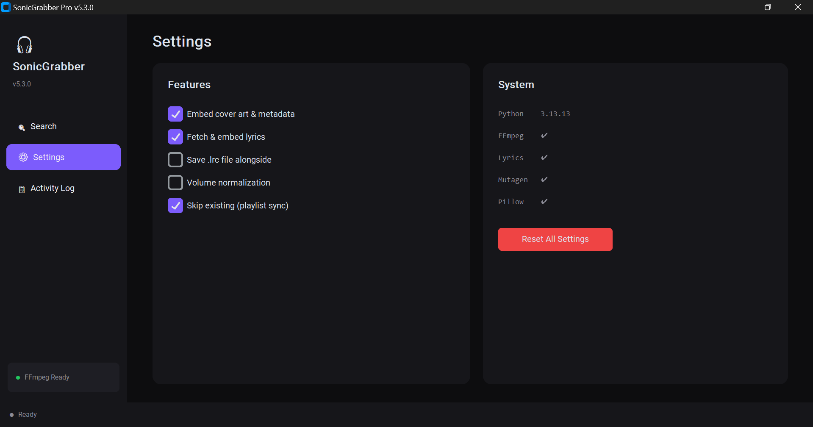
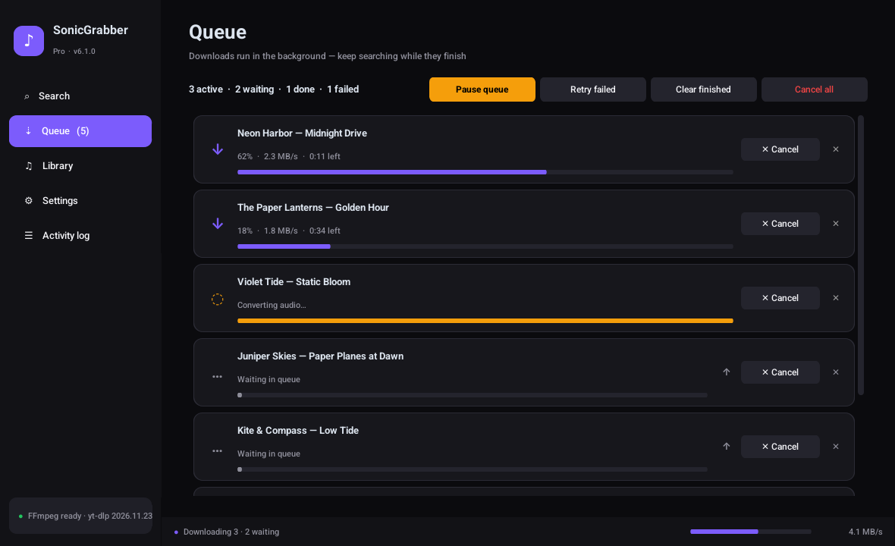
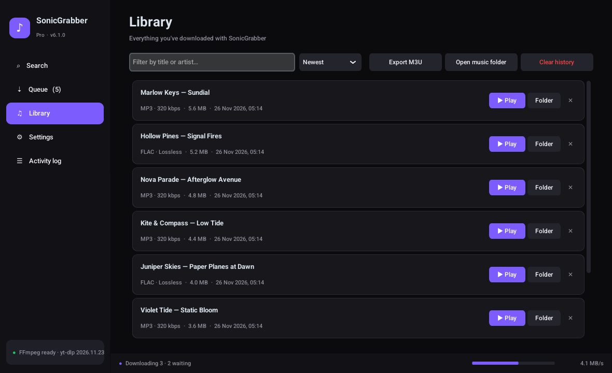
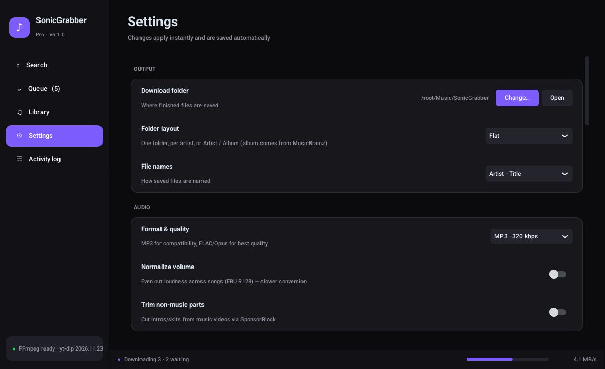

# 🎧 SonicGrabber Pro

**A modern desktop music downloader for Linux.** Search for a song or paste a link, and get MP3, FLAC, M4A or Opus files with cover art, tags and lyrics — all from one clean window.

Built with Python, [CustomTkinter](https://github.com/TomSchimansky/CustomTkinter), [yt-dlp](https://github.com/yt-dlp/yt-dlp) and [FFmpeg](https://ffmpeg.org).



---

## ✨ Features

**Find music**
- Search **YouTube** (and SoundCloud) right inside the app — results come with thumbnails, duration and view counts, ranked so studio uploads appear before live versions and covers
- Paste a **track or playlist link**: playlists open as a list so you can pick the tracks you want
- ▶ **Preview** a result before downloading (needs `mpv`; see below)
- "Songs only" filter hides interviews, mixes and very long videos

**Download**
- A real **queue**: live progress, speed and ETA for every song; pause, cancel, retry, move a song to the front
- Up to **5 downloads at once**, with automatic retries and an optional speed limit
- The queue is **saved** — close the app and unfinished downloads come back next time
- Formats: **MP3** (320/192 kbps) · **FLAC** (lossless) · **M4A** (AAC) · **Opus**

**Tags & library**
- Embeds **cover art** (square-cropped), title, artist and year — ID3v2.3 for MP3, native tags for FLAC / M4A / Opus
- Optional **album info from MusicBrainz** (album, track number, official artwork) and a `Artist / Album` folder layout
- Fetches **lyrics** and embeds them (optionally also saves a `.lrc` file)
- Optional volume normalization (EBU R128)
- **Library** page with search, sorting, duplicate skipping and **M3U playlist export**

**Comfortable to use**
- Dark, light or system theme · interface scale for HiDPI screens
- Toast messages, status bar, desktop notifications when a batch finishes
- Keyboard shortcuts and a command-line mode
- Can add itself to your application menu (Settings → Maintenance)

> Online lookups (MusicBrainz, lyrics, cover art) are best-effort — not every song has a match.

---

## 📸 Screenshots

| Queue | Library | Settings |
| --- | --- | --- |
|  |  |  |

*Screenshots use demo data.*

---

## 🚀 Install

### Option A — ready-made Linux program (easiest)

1. Download the latest `SonicGrabber-Pro-…-linux-x86_64.tar.gz` from the [**Releases**](https://github.com/anshsharma-git/python-music-downloader/releases) page.
2. Extract it (right-click → **Extract Here**).
3. Install FFmpeg once:
   ```bash
   sudo apt install ffmpeg
   ```
4. Open a terminal in the extracted folder and start it:
   ```bash
   ./SonicGrabber
   ```
   *(Permission denied? Run `chmod +x SonicGrabber` first.)*
5. Optional: **Settings → Maintenance → Desktop launcher → Install** adds it to your app menu.

**Works on:** 64-bit Linux with glibc 2.38 or newer — Ubuntu 24.04+, Linux Mint 22+, Fedora 39+, Debian 13+, Arch/Manjaro. On older systems use Option B or build it yourself (see below). You don't need Python for this option.

### Option B — run from source

```bash
sudo apt install python3-tk python3-venv ffmpeg        # Debian / Ubuntu / Mint
git clone https://github.com/anshsharma-git/python-music-downloader.git
cd python-music-downloader
python3 -m venv .venv && . .venv/bin/activate
pip install -r requirements.txt
python3 main.py
```

Optional: `sudo apt install mpv` enables song previews and in-app playback.

> Developed and tested on Linux (Ubuntu 24.04, Python 3.12). Other platforms may work from source but are untested, and the packaged build is Linux-only.

---

## 🧭 First-time setup for YouTube

YouTube now requires a **JavaScript runtime** to unlock downloads. Without one, downloads fail with `HTTP Error 403`.

If SonicGrabber can't find one, a yellow **⚠ Fix YouTube downloads** button appears in the sidebar. Click it: the app downloads [Deno](https://deno.com) (about 40 MB) into its own folder and retries any failed songs. You can check the status under **Settings → Network & access**. Manual alternative: `curl -fsSL https://deno.land/install.sh | sh`.

**Browser cookies (optional):** if YouTube asks you to sign in or shows age-restricted videos, pick your browser under **Settings → Network & access → Browser cookies**. Firefox works out of the box; Chrome, Chromium and Brave use your system password keyring, so unlock it first. SonicGrabber reads them once and keeps them in memory only — it never saves them.

---

## 🕹️ Using it

1. **Search** a song or artist, or **paste a link** (the **Paste** button searches whatever is on your clipboard).
2. Click cards to select several, then **Download selected** — or press **↓ Download** on a single song.
3. Watch progress on the **Queue** page. Finished songs appear in **Library**.

**Shortcuts:** `Ctrl+F` search · `Ctrl+1…5` switch pages · `Ctrl+A` select all results · `Esc` clear the search box · double-click a result's title to open it in your browser.

**Command line:**
```bash
python3 main.py "song name"            # opens the app and searches
python3 main.py -d "song name"         # also downloads the best match
python3 main.py -d "https://…"         # downloads a whole link or playlist
```

### Where things are saved
| What | Location |
| --- | --- |
| Music | `~/Music/SonicGrabber` (change in Settings) |
| Settings | `~/.config/sonicgrabber/config.json` |
| History, queue, log | `~/.local/share/sonicgrabber/` |

---

## 🛠️ Troubleshooting

| Problem | What to do |
| --- | --- |
| Nothing happens when I start it | Run it from a terminal (`./SonicGrabber`) to see messages. A crash report is saved to `~/.local/share/sonicgrabber/crash.log` |
| `HTTP Error 403` on every song | Click **Fix YouTube downloads** (see above) |
| "YouTube returned no downloadable audio" | Open **Activity log** and read the *Why it failed* lines. Try **Browser cookies → None**, or update yt-dlp |
| Downloads suddenly stop working | YouTube changed. Get the newest release, or when running from source: **Settings → Update yt-dlp** |
| "FFmpeg missing" banner | `sudo apt install ffmpeg`, then click **Re-check** |
| Chrome/Brave cookies don't load | Unlock your keyring, or use Firefox — SonicGrabber stops waiting after 35 s and continues without cookies |
| Check everything at once | `./SonicGrabber --selftest` prints what works and what is missing |

**Spotify links aren't supported** — Spotify's audio is DRM-protected and can't be downloaded.

---

## 🏗️ Build the Linux program yourself

```bash
sudo apt install python3-venv python3-tk
./build.sh
```
This creates a fresh virtual environment, installs the newest yt-dlp and builds `./SonicGrabber` with PyInstaller. Because it is built on your machine, it works on your distro even if it is older than Ubuntu 24.04.

---

## 🧰 Built with

[yt-dlp](https://github.com/yt-dlp/yt-dlp) · [FFmpeg](https://ffmpeg.org) · [CustomTkinter](https://github.com/TomSchimansky/CustomTkinter) · [mutagen](https://mutagen.readthedocs.io) · [Pillow](https://python-pillow.org) · [syncedlyrics](https://github.com/moehmeni/syncedlyrics) · [MusicBrainz](https://musicbrainz.org) & [Cover Art Archive](https://coverartarchive.org) · [Deno](https://deno.com) · [PyInstaller](https://pyinstaller.org)

## 📁 Project layout
```
main.py            the whole application
requirements.txt   Python dependencies
build.sh           builds the standalone Linux executable
CHANGELOG.md       what changed between versions
screenshots/       images used in this README
```

## ⚖️ Responsible use

SonicGrabber is a tool for **personal use**. Only download content you own or have permission to download, and respect the terms of the sites you use and the copyright laws of your country. The author is not responsible for misuse.
